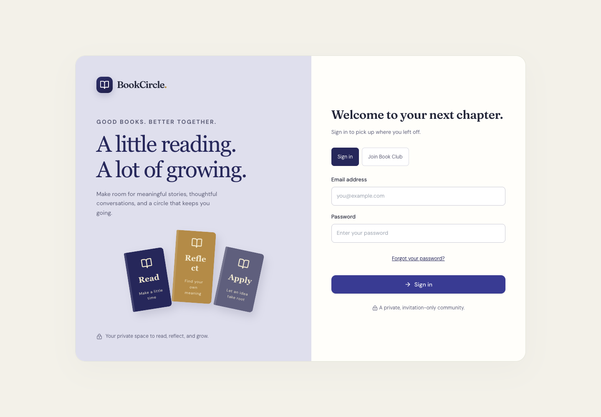
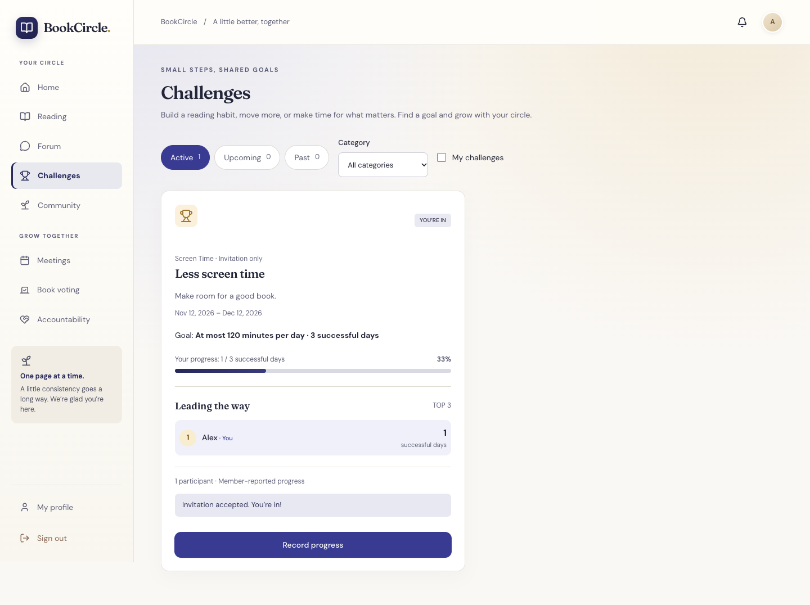

# BookCircle

BookCircle is an invitation-only book club app. Members track what they read, reflect on what they learn, and turn those ideas into commitments. The club can discuss books, choose its next read, and organize meetings in the same place.

## See it in action

**Sign in.** Existing members sign in here; new members register with a club invitation.



**Track a challenge.** This example shows a member logging a day below their screen-time limit. The leaderboard shows aggregate progress; individual daily entries stay private.



Screenshots use sample data.

## What members can do

- **Read:** Browse the club library, organize personal shelves, and log reading to track weekly goals and streaks.
- **Reflect:** Keep private notes, share insights with the club, and discuss books in the forum. Members can also ask questions anonymously.
- **Apply:** Set commitments, check in with an accountability partner, and join reading or habit challenges.
- **Meet:** Vote on the next book, RSVP to meetings, and share a review built around three lessons from a book.

## Tech stack

Next.js App Router, React, TypeScript, Tailwind CSS, and shadcn/ui power the interface. Supabase provides authentication, PostgreSQL, private avatar storage, and Realtime updates. React Hook Form and Zod handle forms, and Recharts displays progress.

## Run locally

Use Node.js 22 or 24 LTS.

```sh
npm ci
cp .env.example .env.local # skip if .env.local already exists
```

Use a Supabase project with the BookCircle migrations applied and fill in `.env.local` with the values below.

| Variable                        | Purpose                                                                   |
| ------------------------------- | ------------------------------------------------------------------------- |
| `NEXT_PUBLIC_SUPABASE_URL`      | Supabase project API URL                                                  |
| `NEXT_PUBLIC_SUPABASE_ANON_KEY` | Publishable API key (the variable name is retained for SDK compatibility) |
| `NEXT_PUBLIC_SITE_URL`          | App origin; localhost for development, deployment URL in production       |

No service-role key or Supabase access token is required by the app. Never expose either in browser environment variables.

Start the app with `npm run dev` and open [http://localhost:3000](http://localhost:3000). To sign in, use an existing club account or register with an invitation. On a fresh project, follow the first-admin bootstrap instructions below.

## Roles

| Role      | Access                                                                                                                            |
| --------- | --------------------------------------------------------------------------------------------------------------------------------- |
| Member    | Personal reading activity and normal club participation                                                                           |
| Moderator | Shared content tools, library, forum moderation, insights, challenges, voting, meetings, prompts, categories, and partner pairing |
| Admin     | All moderator tools plus invitations, member activation, and role assignment                                                      |

Admins assign roles in **Admin tools → Members → Role**. A user cannot change their own role from this screen, and the database prevents demoting the last active administrator. Moderators cannot invite new users to the club, change account access, or assign roles; they can invite existing members to challenges. Private reading records and reflections remain personal. Administrators and moderators can identify anonymous forum authors for moderation.

## Database and security

Apply the SQL in [`supabase/migrations/`](supabase/migrations/) in order. To apply pending migrations with the Supabase CLI, link your own project and run `supabase db push` before deploying the frontend.

Challenges can be open to the club or limited to invited members. Reading challenges can count activity automatically; habit challenges support manual totals, daily thresholds, and check-ins. Leaderboards show the top three positive scores among eligible members. Daily entries and private notes stay personal.

All public tables have RLS. Raw application-table privileges are revoked; authenticated RPCs scope every operation to an active club membership and enforce ownership/admin checks. Anonymous forum DTOs exclude author IDs. Realtime publishes only a club revision counter, never raw author or reading records.

An Auth signup trigger locks and validates a hashed invitation, creates the profile and membership, and consumes the invitation in one transaction. Clients cannot choose their role. The first administrator invitation is issued by a deployment operator with `bootstrap=true`, not by a public endpoint.

Avatars use a private bucket with a 2 MB limit and JPEG/PNG/WebP restrictions. The upload route validates file signatures and uses the member's authenticated session. In-app write requests are rate-limited; Supabase Auth supplies its own authentication rate limits.

## Authentication email and deployment

Supabase Auth handles confirmation and recovery email. Before inviting a production audience, configure a verified SMTP sender in the Supabase dashboard; the default sender restricts delivery. Set Auth **Site URL** to the deployed origin and allow the exact `/auth/callback` and `/auth/callback?next=/reset-password` redirects for your environments. Enable leaked-password protection if available on your Supabase plan.

Deploy this Next.js app to Vercel with the three variables above. `vercel.json` runs `npm run build`; database migrations are applied separately. HTTPS is required for installable PWA behavior.

## Checks

```sh
npm run check        # TypeScript, ESLint, unit tests, production build
npm run test:db      # requires psql and DATABASE_URL; fixtures roll back
npm run test:ui      # with npm run dev running; install Chromium via npx playwright install chromium
```

Alternatively run all three files in `supabase/tests/` in the Supabase SQL editor. The leaderboard suite checks all four metrics, ties, date boundaries, zero activity, small leaderboards, and membership isolation. The application suite exercises real RPCs under the authenticated role, signup/invitation consumption, reading, insights, anonymous discussions, partner privacy, challenges, voting, meetings, and cross-club/inactive-member rejection. The general challenge suite additionally tests invitation states, private visibility, decimal totals, daily maximum/minimum boundaries, check-ins, editing/deletion, accepted-date restrictions, and manager permissions. All fixtures roll back.

The checked-in migrations and code contain no private access credentials. Keep `.env*`, local setup files, and database connection passwords out of Git.

Browser tests use mocked Supabase responses and never create real accounts or challenge entries. Set `PLAYWRIGHT_BASE_URL` for a different local port or `PLAYWRIGHT_EXECUTABLE_PATH` to use an installed Chromium binary.
