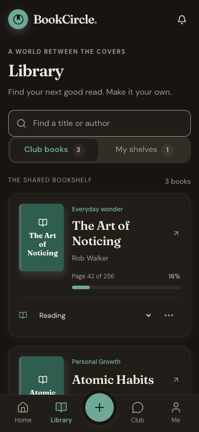
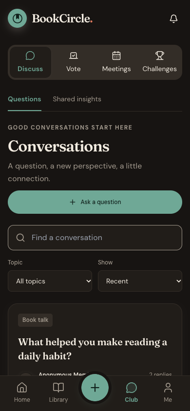
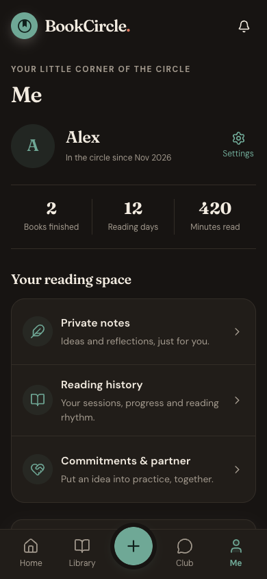

# Library, Club and profile refinement

The reading-room direction is retained: paper and ink, green circular marks, Fraunces headings, and DM Sans controls. This refinement focuses on clearer hierarchy and usable narrow layouts (design feasibility score 14: impact 4, fit 5, feasibility 4, performance 4, consistency risk 3).

- **Library:** cover and title remain beside one another from 320px upward. Compact shelf controls replace the large form on every card; removal and manager editing remain under each book's labeled options control. Search, shelf counts, progress, book details and all shelf states remain available. Empty search results have their own clear/reset action.
- **Club:** icon-and-label navigation groups Discuss, Vote, Meetings and Challenges. Questions and shared insights have clear sub-navigation. Topic and sort filters sit above the full-width conversation list; the cramped topics sidebar and promotional panel are removed. Search explicitly spans all topics. Existing query arguments, anonymous DTOs and moderation permissions are preserved.
- **Me:** a recognizable profile header includes a Settings link and compact personal totals. Private notes, reading history, and commitments/partner are separate, clearly labeled destinations with a way back. The weekly goal remains below those shortcuts. Account/avatar/password/privacy controls remain in Settings.

Validation: `npm run check` passed (10 unit tests, typecheck, lint, production build). Browser suite: 19 passed, one optional original-app capture skipped. Coverage includes browser coverage at 320, 390, 768 and 1280px; light/dark rendered-text contrast; Library search, shelf assignment and removal; profile destinations and back links; Club filter queries; existing reading, RSVP, voting, private notes, anonymity, challenge and role tests. Screenshots use mocked data.

No database, auth, invitation, environment, or server permission files changed. No dependency was added.

## Screenshots

| Library | Club | Me |
| --- | --- | --- |
|  |  |  |

[320px Library](screenshots/library-320.png) · [Desktop Club](screenshots/club-desktop.png)
